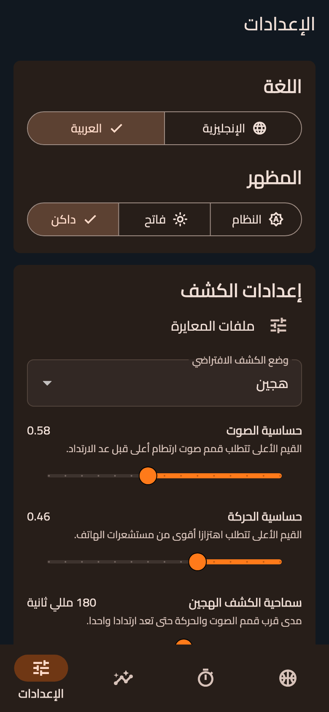
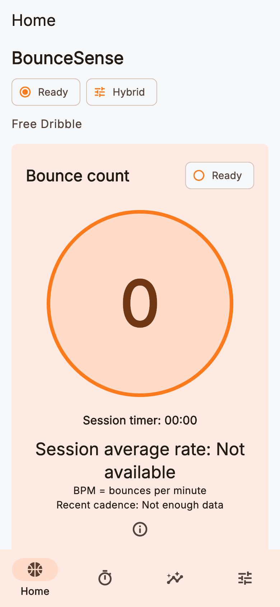
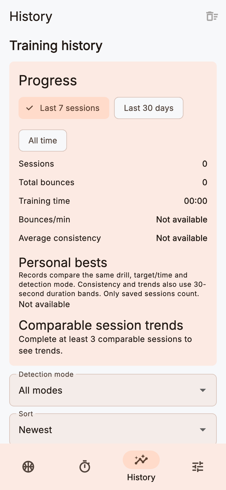

# BounceSense — عرض المشروع

[English](README.md) · [Türkçe](README.tr.md) · [العربية](README.ar.md)

**منتج من ايديابات · Android / iOS · EN / AR**

تطبيق Flutter لتدريب كرة السلة، يقدّر الارتدادات بالصوت والحركة والوضع الهجين، مع سجل محلي وواجهة بالعربية والإنجليزية.

تحقق 16 نوفمبر 2026: موقع المنتج وGoogle Play متاحان؛ وتبقى قدرات التدريب والعمل دون اتصال في 1.1.1 موسومة كمعاينة من المصدر. أفاد المالك بقبول iOS وانتشاره إقليميًا، لكن صفحة App Store الأمريكية المقدمة لم تكن متاحة في هذا التحقق.

الإعدادات بالعربية من اليمين إلى اليسار بالمظهر الداكن؛ معاينة من المصدر.

## التحدي

لا يكفي عرض عدد متزايد أثناء التدريب؛ فهناك توقفات وأرضيات مختلفة وإشارات غير مؤكدة. يحتاج المنتج إلى حفظ سياق الجلسة وتوضيح حدود ما يقيسه.

مخصص للتدريب الفردي على المراوغة بكرة السلة ولمن يريد مراجعة جلساته. هذا وصف للاستخدام المقصود، وليس ادعاءً بوجود شريحة عملاء مقاسة أو نظام لإدارة المدربين.

## الحل

يجمع BounceSense تقدير الارتدادات والتحكم في الجلسة ومراجعة نتائجها ضمن تجربة جوال واحدة. يستطيع المستخدم اختيار الكاشف وضبط الحساسية وحفظ الجلسة دون إنشاء حساب. يتضمن مصدر الإصدار 1.1.1 الذي جرى فحصه أربعة تمارين وتحليلًا زمنيًا يراعي التوقف المؤقت وأهدافًا محلية وسجلات لجلسات قابلة للمقارنة وملفات معايرة مسماة. تُعرض هذه القدرات الأحدث كمعاينة من المصدر إلى أن يتأكد توزيعها عبر المتاجر.

- **اختر هدف التدريب.** المراوغة الحرة وهدف عدد الارتدادات والتحدي الزمني وتدريب الإيقاع تستخدم الكاشف وعناصر التحكم نفسها. هذه معاينة مصدر الإصدار 1.1.1.
- **افهم معنى القياس.** يتابع الصوت قمم الاصطدامات، وتقيس الحركة تسارع الهاتف. يجمع الهجين الإشارات ويمكنه قبول إشارة منفردة قوية. تبقى النتائج تقديرات.
- **راجع التوقيت ضمن سياقه.** تُستبعد فترات التوقف من الوقت النشط. يختلف متوسط الجلسة عن المعدل الحديث، ويُذكر نقص البيانات بوضوح. هذا سلوك المصدر الحالي.
- **احتفظ بالسجل محليًا.** تُحفظ الجلسات والملاحظات والأهداف وملفات المعايرة على الجهاز دون حساب. لا توجد ميزة منفذة للتصدير أو المزامنة السحابية.
- **استخدم العربية أو الإنجليزية.** يدعم الاتجاه من اليمين إلى اليسار والخطوط المضمنة وخيارات المظهر اللغتين. التركية لغة المواد التحريرية فقط.

## مسار التدريب

1. اختر التمرين والكاشف المناسب.
2. تحقق من موضع آمن للهاتف وقارن تجربة قصيرة بعدّ يدوي.
3. ابدأ وأوقف مؤقتًا أو استأنف، ثم راجع الأحداث المكتشفة.
4. احفظ أو تجاهل النتيجة وأضف ملاحظات وارجع إلى السجل المحلي.

## نطاق التسليم

- تطبيق Flutter يستهدف Android وiOS/iPadOS
- مسارات الرئيسية والتدريب والسجل والإعدادات
- حفظ الجلسات والملفات والأهداف على الجهاز
- واجهة عربية/إنجليزية مع RTL ومظهر فاتح وداكن وتلقائي
- موقع PHP للمنتج والدعم والمعلومات القانونية

التطبيق والموقع: العربية والإنجليزية. المواد التحريرية: الإنجليزية والتركية والعربية.

## نقاط القوة التقنية

- فصل خدمات الكواشف عن إدارة دورة حياة الجلسة
- حساب الوقت النشط بساعة رتيبة وحالة استعادة واضحة
- ترحيل البيانات المحلية وحدود سجل دون حذف صامت
- تدريب دون اتصال في المصدر الحالي مع خدمات شبكة اختيارية

يعتمد التطبيق على Flutter وDart، مع Provider للحالة وSharedPreferences لحفظ JSON محليًا وrecord وsensors_plus لإشارات الجهاز. تُفصل تكاملات Google Mobile Ads/UMP وin_app_review عن التدريب. يستخدم الموقع PHP وHTML وCSS وJavaScript. لا يوجد نظام حسابات أو خادم تدريب أو لوحة ويب.

تُحفظ التفضيلات وملخصات JSON المنظمة على الجهاز. يدعم المصدر الحالي نتائج التوقيت والملاحظات والأهداف وملفات المعايرة، دون واجهة خادم للجلسات أو مزامنة حسابات. يحافظ فك البيانات المحمي على المجاميع القديمة القابلة للقراءة دون اختلاق أزمنة أحداث مفقودة. تدعم اللقطات الدورية وهوية الجلسة الثابتة الاستعادة وتمنع تكرار السجلات المحفوظة. المقابل هو متانة محلية محدودة: قد يضيع العمل الأحدث غير المحفوظ بعد إغلاق مفاجئ، ولا توجد خدمة منفذة للتصدير أو الاستعادة السحابية. وتطلب حدود السجل تنظيفًا صريحًا بدل الحذف التلقائي.

يبقى التدريب في المصدر الحالي متاحًا دون اتصال. أما الإعلانات والموافقة والروابط الخارجية وتقييمات المتجر فهي قدرات منفصلة تعتمد على الشبكة. لا يحفظ التطبيق عمدًا التسجيلات الخام للميكروفون ولا يرفع تدفقات المستشعرات المستمرة، لكن ذلك لا يعني غياب حركة الشبكة: قد تعالج خدمات الإعلان والموافقة معلومات الجهاز والشبكة. تُدار نسخ نظام التشغيل الاحتياطية بشكل مستقل. تُطلب الأذونات عند الحاجة، ويُنسق عرض الإعلانات والتقييمات حول الجلسة والتفاعلات القانونية. يبقى سلوك SDK الأصلي بحاجة إلى تحقق على جهاز فعلي.

## الصور والتعليقات

صور التطبيق تصيير فعلي لواجهة Flutter الحالية ببيانات محلية فارغة، وليست دليلًا على جهاز أصلي أو تجربة ملعب. صور الموقع ملتقطة مباشرة من المتصفح. تحافظ التعليقات على هذا التمييز.

الشاشة الرئيسية بالإنجليزية قبل بدء جلسة؛ معاينة من المصدر ببيانات فارغة.

سجل محلي فارغ يوضح عدم توافر الأرقام القياسية والاتجاهات؛ معاينة من المصدر.

الإعدادات بالعربية من اليمين إلى اليسار بالمظهر الداكن؛ معاينة من المصدر.

## حقائق المشروع

طوّرت ايديابات مسارات الجوال وتكامل الكواشف والحفظ المحلي والواجهة ثنائية اللغة وموقع PHP. أكد صاحب المنتج الملكية وفترة المشروع من أكتوبر إلى نوفمبر 2026.

أكتوبر–نوفمبر 2026؛ بحسب المالك، بدقة الشهر فقط.

يوفر المصدر المفحوص مسارًا مترابطًا للإعداد والتدريب والمراجعة. أفاد صاحب المنتج بأن حالته LIVE، وصفحة Android متاحة للعامة. لا تُطرح مؤشرات لاستخدام العملاء أو الإيرادات أو دقة الكشف أو التحسن الرياضي.

## الروابط الرسمية

- [موقع المنتج — تحقق مباشر](https://bouncesense.ideabatapps.com/)
- [Google Play — تحقق مباشر](https://play.google.com/store/apps/details?id=bouncesense.ideabat.com)
- [App Store — رابط المالك؛ الإتاحة الأمريكية غير متحققة](https://apps.apple.com/us/app/bouncesense/id6795583456)

## Ideabat

جرى التحقق من إتاحة صفحات ايديابات التالية في 16 نوفمبر 2026. وهي تحتوي حاليًا على نص سابق للمشروع؛ ولم يُنشر هذا التحديث خلال هذه المهمة.

**معرض الأعمال:** [English](https://ideabat.com/portfolio/bouncesense-basketball-training-app/) · [Türkçe](https://ideabat.com/tr/portfolio/bouncesense-basketball-training-app/) · [العربية](https://ideabat.com/ar/portfolio/bouncesense-basketball-training-app/)

**دراسة الحالة:** [English](https://ideabat.com/case-study/bouncesense-local-first-bounce-tracking/) · [Türkçe](https://ideabat.com/tr/case-study/bouncesense-local-first-bounce-tracking/) · [العربية](https://ideabat.com/ar/case-study/bouncesense-local-first-bounce-tracking/)

## الملكية والمراجعة التقنية

يحتوي هذا المستودع على توثيق ومواد مرئية معتمدة، وليس إصدارًا لشفرة التطبيق. BounceSense منتج من ايديابات، ولا يمنح عرضه هنا حقوق ملكية أو ينقلها. للاستفسارات المتعلقة بالتوظيف أو التعاون أو المراجعة التقنية، تواصل مع Ragıp Mullamusa عبر ايديابات. يتطلب الوصول إلى شفرة التطبيق الخاصة إذنًا مسبقًا من مالك المشروع والالتزام بمتطلبات السرية ذات الصلة. تُراجع الطلبات بصورة فردية، ولا يُضمن منح الوصول إلى المصدر. لا يمنح هذا العرض ترخيصًا برمجيًا أو إذنًا بإعادة التوزيع.

Ragıp Mullamusa هو مؤسس [ايديابات](https://ideabat.com/). للاستفسارات ذات الصلة بالهندسة أو التوظيف أو التعاون، استخدم [صفحة التواصل](https://ideabat.com/contact-us/) أو [info@ideabat.com](mailto:info@ideabat.com).

