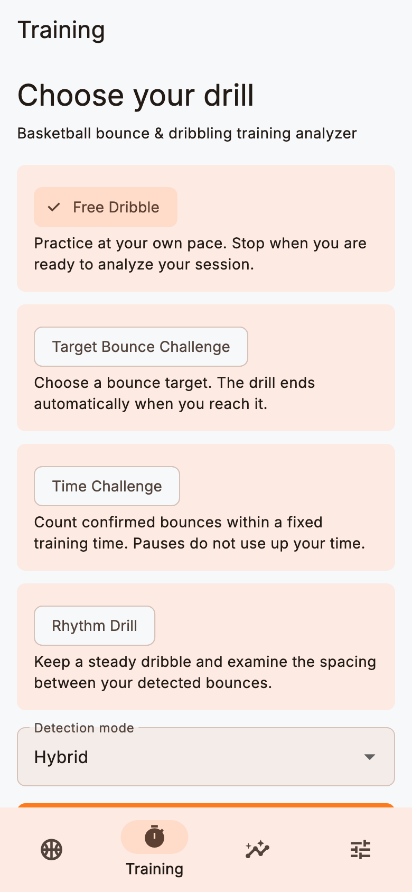
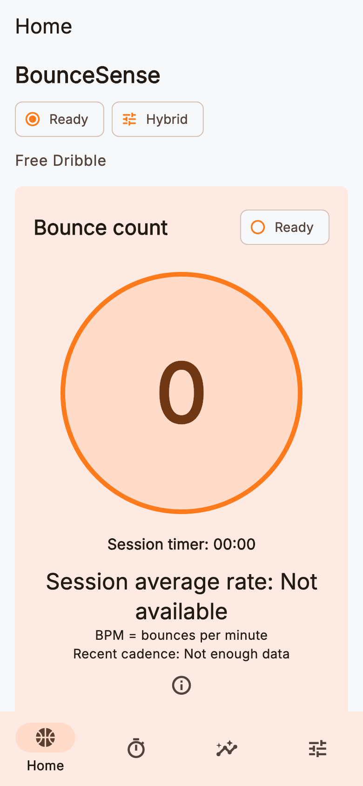
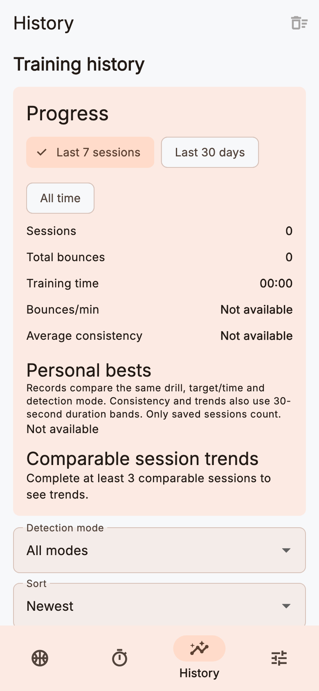
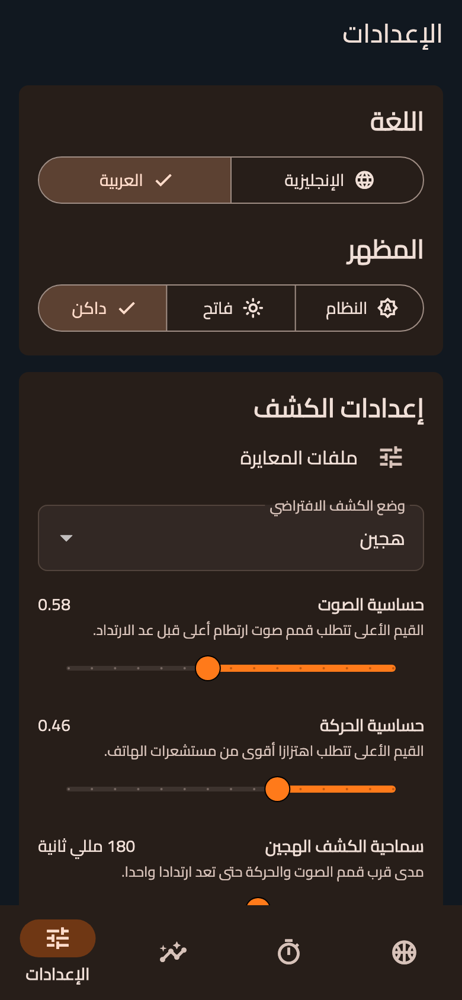

# BounceSense — Project Showcase

[English](README.md) · [Türkçe](README.tr.md) · [العربية](README.ar.md)

**Ideabat Product · Android / iOS · EN / AR**

A Flutter basketball practice app with Sound, Motion and Hybrid bounce estimation, local session history and English/Arabic interfaces.

Checked 16 November 2026: product website and Google Play are live; 1.1.1 training/offline capabilities remain labeled a source preview. The owner reports iOS acceptance and regional rollout; the supplied US App Store page was not publicly available to this check.

Four drill choices in the 1.1.1 source preview.

## Challenge

A counter needs more than an increasing number: practice includes interruptions, different surfaces and uncertain signals. The product must preserve session context and make the limits of its measurements understandable.

Designed for individual basketball dribbling practice and people reviewing their own sessions. This is an intended use case, not a claim of a measured customer cohort or a coach-management system.

## Solution

BounceSense brings bounce estimation, session control and review into one mobile workflow. People can choose a detector, adjust sensitivity and save a session without creating an account. The inspected 1.1.1 source adds a structured choice of four drills, pause-aware timing analysis, local goals, comparable-session records and named calibration profiles. These newer capabilities are presented as a source preview until store delivery is confirmed.

- **Choose a practice objective.** Free Dribble, Target Bounce Challenge, Time Challenge and Rhythm Drill share the existing detector and session controls. Current 1.1.1 source preview.
- **Understand the measurement.** Sound follows impact peaks; Motion senses phone acceleration; Hybrid combines signals and can accept a strong single signal. Results remain estimates.
- **Review timing with context.** Active-time intervals exclude pauses. Average pace and recent cadence are distinct, and insufficient data is shown explicitly. Current-source behavior.
- **Keep practice history locally.** Sessions, notes, goals and profiles use local storage without an account. There is no implemented export or cloud sync.
- **Use English or Arabic.** RTL Arabic, bundled typography and adjustable themes support both writing directions. Turkish is editorial only.

## Practice workflow

1. Choose a drill and a suitable detector.
2. Check placement and calibrate against a short manually counted trial.
3. Start, pause or resume; finish and review detected events.
4. Save or discard, add notes and revisit local history.

## Deliverables

- Flutter app targets for Android and iOS/iPadOS
- Home, Training, History and Settings workflows
- Local session, profile and goal storage
- English/Arabic interface, RTL and light/dark/system themes
- PHP product, support and legal website

App/site: English and Arabic. Editorial: English, Turkish and Arabic.

## Engineering strengths

- Separate detector services and session lifecycle coordination
- Monotonic active-time accounting and explicit recovery state
- Local data migrations and bounded history without silent purging
- Offline current-source practice with optional network services

Flutter and Dart provide the mobile app, Provider coordinates state, SharedPreferences stores local JSON, and record/sensors_plus supply device signals. Google Mobile Ads/UMP and in_app_review are optional integration boundaries. The public site uses PHP, HTML, CSS and JavaScript. There is no account system, training backend or web dashboard.

Preferences and structured JSON summaries are stored on the device. The current source supports timing results, notes, goals and calibration profiles, without a training server API or account sync. Guarded decoding preserves readable legacy totals without inventing missing event times. Periodic snapshots and stable session identity support recovery and avoid duplicate saved sessions. The tradeoff is finite local durability: an abrupt stop can lose recent unsnapshotted work, and there is no implemented export or cloud recovery service. History limits prompt explicit cleanup instead of silent deletion.

Current-source training remains available offline. Ads, consent, external links and store reviews remain separate network-dependent capabilities. The app does not intentionally save raw microphone recordings or upload continuous sensor streams, but that does not mean it has no network traffic: advertising and consent services may process device/network information. OS backups are managed separately. Permission requests are contextual, and ad/review presentation is coordinated around session and legal interactions. Native SDK behavior still needs real-device validation.

## Media and captions

All app images are actual current-source Flutter renders with empty local data, not native device or court evidence. Website images are direct live-browser captures. Captions preserve this distinction.

English Home ready for a new session; source preview with zero data.

Empty local history makes unavailable records and trends explicit; source preview.

Arabic right-to-left Settings in dark theme; source preview.

## Project facts

Ideabat developed the mobile workflows, detector integration, local persistence, bilingual UI and companion PHP site. Product ownership and the October–November 2026 project period are owner-confirmed.

October–November 2026; owner-confirmed, month precision.

The delivered source provides a coherent prepare–practice–review workflow. The product is owner-reported LIVE and its Android listing is publicly reachable. No adoption, revenue, accuracy or athletic-improvement KPI is asserted.

## Official links

- [Product website — live verified](https://bouncesense.ideabatapps.com/)
- [Google Play — live verified](https://play.google.com/store/apps/details?id=bouncesense.ideabat.com)
- [App Store — owner-supplied; US public availability unverified](https://apps.apple.com/us/app/bouncesense/id6795583456)

## Ideabat

Ideabat pages below were live-verified on 16 November 2026. They currently contain earlier project copy; this showcase update has not been published by this task.

**Portfolio:** [English](https://ideabat.com/portfolio/bouncesense-basketball-training-app/) · [Türkçe](https://ideabat.com/tr/portfolio/bouncesense-basketball-training-app/) · [العربية](https://ideabat.com/ar/portfolio/bouncesense-basketball-training-app/)

**Case study:** [English](https://ideabat.com/case-study/bouncesense-local-first-bounce-tracking/) · [Türkçe](https://ideabat.com/tr/case-study/bouncesense-local-first-bounce-tracking/) · [العربية](https://ideabat.com/ar/case-study/bouncesense-local-first-bounce-tracking/)

## Ownership and technical review

This repository contains documentation and approved visual material, not an application source release. BounceSense is an Ideabat product; presentation here does not grant or transfer ownership rights. For employment, collaboration or technical-review inquiries, contact Ragıp Mullamusa through Ideabat. Access to the private application source requires prior permission from the project owner and compliance with applicable confidentiality requirements. Requests are reviewed individually; source access is not guaranteed. No software license or redistribution permission is granted by this showcase.

Ragıp Mullamusa is the founder of [Ideabat](https://ideabat.com/). For relevant engineering, employment or collaboration inquiries, use [the contact page](https://ideabat.com/contact-us/) or [info@ideabat.com](mailto:info@ideabat.com).
