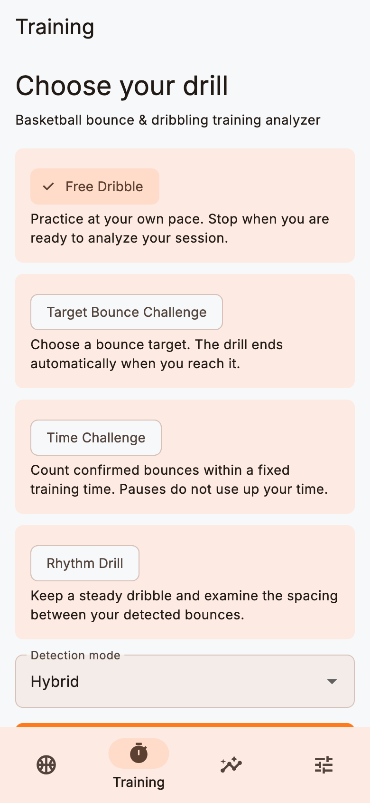
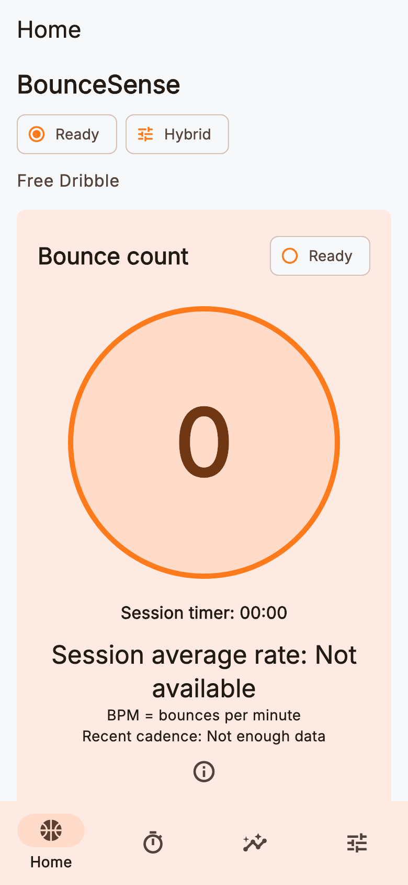
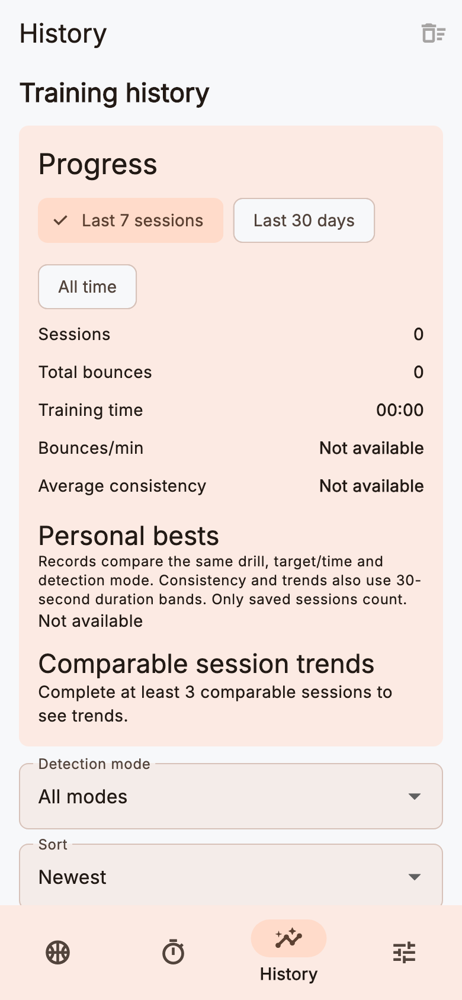
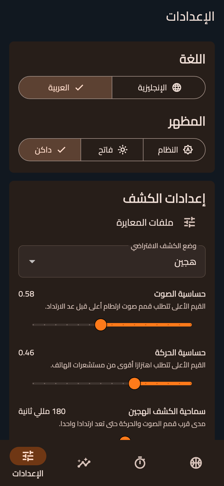

# BounceSense — Proje Sunumu

[English](README.md) · [Türkçe](README.tr.md) · [العربية](README.ar.md)

**Ideabat Ürünü · Android / iOS · EN / AR**

Ses, Hareket ve Hibrit algılama, yerel seans geçmişi ve İngilizce/Arapça arayüz sunan Flutter tabanlı basketbol antrenman uygulaması.

16 Kasım 2026 kontrolü: ürün sitesi ve Google Play yayındadır; 1.1.1 antrenman/çevrimdışı özellikleri kaynak önizlemesi olarak etiketlenir. Ürün sahibi iOS kabulü ve bölgesel yayılım bildirmiştir; verilen ABD App Store sayfasına bu kontrolde erişilememiştir.

1.1.1 kaynak önizlemesinde dört antrenman seçeneği.

## Sorun

Antrenman sırasında duraklamalar, farklı zeminler ve belirsiz sinyaller vardır. Artan bir sayının ötesinde, seans bağlamını koruyan ve ölçüm sınırlarını anlaşılır biçimde gösteren bir deneyim gerekir.

Bireysel basketbol top sürme antrenmanı yapan ve kendi seanslarını incelemek isteyen kişiler için tasarlanmıştır. Bu tanım bir kullanım amacı belirtir; ölçülmüş müşteri kitlesi veya antrenör yönetim sistemi iddiası değildir.

## Çözüm

BounceSense, sektirme tahminini, seans yönetimini ve sonuç incelemeyi tek bir mobil akışta birleştirir. Kullanıcı hesap açmadan algılama yöntemini seçebilir, hassasiyeti ayarlayabilir ve seansı kaydedebilir. İncelenen 1.1.1 kaynağında dört antrenman türü, duraklamaları hesaba katan zamanlama analizi, yerel hedefler, karşılaştırılabilir seans rekorları ve adlandırılmış kalibrasyon profilleri bulunur. Bu yeni özellikler, mağazadan dağıtıldıkları doğrulanana kadar kaynak önizlemesi olarak sunulur.

- **Antrenmanın amacını seçin.** Serbest top sürme, hedef sektirme sayısı, süreli çalışma ve ritim antrenmanı aynı algılayıcı ve seans kontrollerini kullanır. Mevcut 1.1.1 kaynak önizlemesidir.
- **Ölçümün ne anlattığını bilin.** Ses modu darbe seslerini, Hareket modu telefonun ivmesini izler. Hibrit mod sinyalleri birleştirir ve güçlü tek bir sinyali de kabul edebilir. Sonuçlar tahmindir.
- **Zamanlamayı bağlamıyla inceleyin.** Etkin süre hesaplaması duraklamaları dışarıda bırakır. Seans ortalaması ile son dönemin ritmi ayrıdır; yetersiz veri açıkça belirtilir.
- **Geçmişi cihazınızda tutun.** Seanslar, notlar, hedefler ve profiller hesap açmadan yerelde saklanır. Dışa aktarma veya bulut eşitlemesi uygulanmış değildir.
- **İngilizce veya Arapça kullanın.** Sağdan sola Arapça düzen, uygulamayla gelen yazı tipleri ve tema seçenekleri iki yazı yönünü destekler. Türkçe yalnızca tanıtım belgelerinin dilidir.

## Antrenman akışı

1. Antrenman türünü ve uygun algılama yöntemini seçin.
2. Güvenli yerleşimi kontrol edin; kısa bir denemeyi elle sayarak karşılaştırın.
3. Başlatın, duraklatın veya sürdürün; tamamlanınca algılanan olayları inceleyin.
4. Kaydedin ya da vazgeçin; not ekleyin ve yerel geçmişe dönün.

## Teslim edilen kapsam

- Android ve iOS/iPadOS hedefli Flutter uygulaması
- Ana Sayfa, Antrenman, Geçmiş ve Ayarlar akışları
- Cihazda seans, profil ve hedef saklama
- İngilizce/Arapça arayüz, RTL ve açık/koyu/sistem temaları
- PHP ürün, destek ve yasal bilgi sitesi

Uygulama/site: İngilizce ve Arapça. Belgeler: İngilizce, Türkçe ve Arapça.

## Teknik güçlü yönler

- Algılayıcı servisleriyle seans yaşam döngüsünün ayrılması
- Monotonik etkin süre hesabı ve açık kurtarma durumu
- Eski veriyi koruyan dönüşümler ve sessiz silme yapmayan geçmiş sınırları
- Mevcut kaynakta çevrimdışı antrenman ve isteğe bağlı ağ servisleri

Mobil uygulama Flutter ve Dart ile geliştirilmiştir; Provider durumu, SharedPreferences yerel JSON saklamayı, record/sensors_plus ise cihaz sinyallerini sağlar. Google Mobile Ads/UMP ve in_app_review ayrı entegrasyonlardır. Genel site PHP, HTML, CSS ve JavaScript kullanır. Hesap sistemi, antrenman sunucusu veya web paneli yoktur.

Tercihler ve yapılandırılmış JSON seans özetleri cihazda saklanır. Mevcut kaynak; zamanlama sonuçları, notlar, hedefler ve kalibrasyon profilleri sunar; seans API’si veya hesap eşitlemesi içermez. Korumalı çözümleme eski toplamları korur, eksik olay zamanlarını uydurmaz. Periyodik anlık kayıtlar ve kararlı seans kimliği kurtarmayı destekler, yinelenen kayıtları önler. Buna karşılık ani kapanma son kayıttan sonraki işi kaybettirebilir; dışa aktarma veya buluttan kurtarma uygulanmış değildir. Geçmiş sınırları veriyi sessizce silmek yerine açık temizlik gerektirir.

Mevcut kaynakta antrenman çevrimdışı kullanılabilir. Reklamlar, rıza akışları, dış bağlantılar ve mağaza değerlendirmeleri ağ bağlantısına bağlı ayrı yeteneklerdir. Uygulama ham mikrofon kayıtlarını kalıcı olarak saklamaz veya sürekli sensör akışlarını yüklemez. Ancak bu, hiç ağ trafiği olmadığı anlamına gelmez: reklam ve rıza servisleri cihaz/ağ bilgilerini işleyebilir. İşletim sistemi yedekleri ayrıca yönetilir. İzinler gerektiğinde istenir; reklam ve değerlendirme gösterimi etkin seans ve yasal belge akışlarından ayrı koordine edilir. Yerel SDK davranışı gerçek cihazda doğrulanmalıdır.

## Görseller ve açıklamaları

Uygulama görselleri boş yerel veriyle gerçek Flutter kaynağından üretilmiştir; yerel cihaz veya saha kanıtı değildir. Web görselleri canlı tarayıcıdan alınmıştır. Açıklamalar bu ayrımı korur.

Yeni seansa hazır İngilizce Ana Sayfa; boş verilerle kaynak arayüz önizlemesi.

Boş yerel geçmişte henüz hesaplanamayan rekorlar ve eğilimler; kaynak önizlemesi.

Koyu temada sağdan sola Arapça Ayarlar; kaynak önizlemesi.

## Proje bilgileri

Mobil akışlar, algılayıcı entegrasyonu, yerel saklama, iki dilli arayüz ve PHP sitesi Ideabat tarafından geliştirilmiştir. Ürün sahipliği ve Ekim–Kasım 2026 proje dönemi ürün sahibi tarafından bildirilmiştir.

Ekim–Kasım 2026; ürün sahibi tarafından bildirildi, ay hassasiyetinde.

İncelenen kaynak, hazırlık–antrenman–inceleme akışını bir arada sunar. Ürün sahibi durumu LIVE olarak bildirmiştir ve Android mağaza sayfası erişilebilirdir. Kullanıcı sayısı, gelir, algılama doğruluğu veya sportif gelişim metriği ileri sürülmez.

## Resmî bağlantılar

- [Ürün sitesi — erişimi doğrulandı](https://bouncesense.ideabatapps.com/)
- [Google Play — erişimi doğrulandı](https://play.google.com/store/apps/details?id=bouncesense.ideabat.com)
- [App Store — sahibinin verdiği URL; ABD erişimi doğrulanmadı](https://apps.apple.com/us/app/bouncesense/id6795583456)

## Ideabat

Aşağıdaki Ideabat sayfalarının erişimi 16 Kasım 2026’da doğrulandı. Sayfalar önceki proje metinlerini içeriyor; bu sunum güncellemesi bu çalışma sırasında yayımlanmadı.

**Portföy:** [English](https://ideabat.com/portfolio/bouncesense-basketball-training-app/) · [Türkçe](https://ideabat.com/tr/portfolio/bouncesense-basketball-training-app/) · [العربية](https://ideabat.com/ar/portfolio/bouncesense-basketball-training-app/)

**Vaka incelemesi:** [English](https://ideabat.com/case-study/bouncesense-local-first-bounce-tracking/) · [Türkçe](https://ideabat.com/tr/case-study/bouncesense-local-first-bounce-tracking/) · [العربية](https://ideabat.com/ar/case-study/bouncesense-local-first-bounce-tracking/)

## Sahiplik ve teknik inceleme

Bu depo, uygulamanın kaynak kodu yayını değil, belgeler ve onaylanmış görsel materyaller içerir. BounceSense bir Ideabat ürünüdür; burada sunulması sahiplik hakkı vermez veya devretmez. İş fırsatları, iş birliği veya teknik inceleme talepleri için Ideabat üzerinden Ragıp Mullamusa ile iletişime geçin. Özel uygulama kaynağına erişim, proje sahibinin önceden iznini ve geçerli gizlilik koşullarına uyulmasını gerektirir. Talepler ayrı ayrı değerlendirilir; kaynak erişimi garanti edilmez. Bu sunum herhangi bir yazılım lisansı veya yeniden dağıtım izni vermez.

Ragıp Mullamusa, [Ideabat’ın](https://ideabat.com/) kurucusudur. İlgili mühendislik, iş fırsatı veya iş birliği talepleri için [iletişim sayfasını](https://ideabat.com/contact-us/) ya da [info@ideabat.com](mailto:info@ideabat.com) adresini kullanabilirsiniz.
